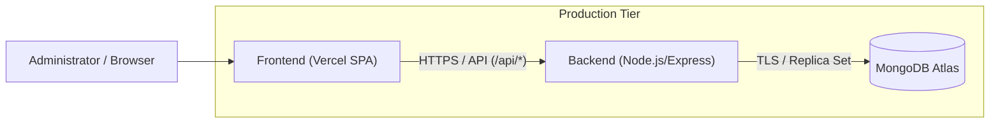

# CPN RAJA – FINANCE MANAGEMENT SYSTEM
## PRODUCTION DEPLOYMENT & OPERATIONS MANUAL

**Application:** CPN RAJA – FINANCE MANAGEMENT SYSTEM  
**Target Environment:** Vercel (Frontend) + Node.js/Express (Backend API) + MongoDB Atlas (Database)  
**Git Repository:** https://github.com/sherpa11/CPN-Finance-Management.git  

---

## 1. ARCHITECTURE & MULTI-TIER DESIGN

The system is decoupled into three high-performance, independently scalable tiers:



1. **Frontend Tier (Vercel):**
   - React 19 Single Page Application bundled with Vite.
   - Tailwind CSS responsive layout tested from 320px mobile to 1920px 4K.
   - Pure client-side routing with `vercel.json` rewrite protection for SPA page refresh.
   - Connects to backend via `VITE_API_URL` environment variable or relative `/api` reverse proxy.

2. **Backend API Tier (Node.js / Express):**
   - Express 5.3 runtime with Helmet security headers, Gzip compression, and Morgan logging.
   - Two-tier rate limiting: General API limiter (1000 req/15min) + Strict Login brute-force limiter (30 req/15min).
   - Strict Integer Paise calculation engine with zero floating-point arithmetic.
   - Independent service boundaries for:
     - **Monthly Finance**
     - **Daily Finance**
     - **Daily Collection (Scheme A: 70 & 100 Days Upfront Interest)**
     - **மொய் / சீர் (Moi / Seer)**
     - **சீட்டு / Chit Fund (₹5L, ₹10L, ₹20L Groups)**
     - **Notifications & Due Management (Asia/Kolkata timezone)**

3. **Database Tier (MongoDB Atlas):**
   - 3-node replica set cluster supporting multi-document ACID transactions.
   - Comprehensive compound indexes for sub-25ms aggregations.
   - Zero hard deletions: financial corrections handled via audited reversals (`status: REVERSED`).

---

## 2. PRODUCTION ENVIRONMENT VARIABLES

### Backend Configuration (`backend/.env`):

| Variable Name | Required | Default / Example Value | Purpose |
| :--- | :---: | :--- | :--- |
| `PORT` | Optional | `5000` | Port for Express HTTP server |
| `NODE_ENV` | **Yes** | `production` | Set to `production` to activate production safeguards |
| `MONGODB_URI` | **Yes** | `mongodb+srv://<user>:<pwd>@cluster.mongodb.net/cpn_raja_vatti_db?retryWrites=true&w=majority` | MongoDB Atlas replica set connection string |
| `JWT_SECRET` | **Yes** | *Min 32-character random string* | Cryptographic key for signing admin authentication tokens |
| `JWT_EXPIRES_IN` | Optional | `7d` | Lifetime of issued authentication sessions |
| `CORS_ORIGIN` | **Yes** | `https://your-frontend.vercel.app` | Allowed origins (comma-separated or `*`) |
| `TIMEZONE` | Optional | `Asia/Kolkata` | Standard Indian business timezone |
| `APP_NAME` | Optional | `"CPN RAJA – FINANCE MANAGEMENT SYSTEM"` | Application branding display |
| `BUSINESS_OWNER` | Optional | `"CPN Raja"` | Owner name printed on vouchers and receipts |
| `DEFAULT_REMINDER_DAYS`| Optional | `3` | Advance window for due notifications |

### Frontend Configuration (`frontend/.env`):

| Variable Name | Required | Default / Example Value | Purpose |
| :--- | :---: | :--- | :--- |
| `VITE_API_URL` | Optional | `https://your-backend-api.onrender.com/api` | Full URL to backend API. If omitted, defaults to `/api` for same-origin proxy |

---

## 3. INITIAL PRODUCTION DATABASE SETUP

### Step 1: Create MongoDB Atlas Cluster
1. Create a cluster on [MongoDB Atlas](https://www.mongodb.com/cloud/atlas).
2. Create a database user with Read/Write permissions to `cpn_raja_vatti_db`.
3. In Network Access, allow your backend host IP address (or `0.0.0.0/0` with strong authentication).
4. Copy the connection string into your backend environment variable `MONGODB_URI`.

### Step 2: Initialize Configurations & Business Rules
Run the non-destructive seed script to initialize calculation configurations and business parameters:
```bash
cd backend
npm run seed
```

### Step 3: Provision Production Administrator
Provision the initial administrative account with secure password hashing:
```bash
# Interactive or environment-driven
npm run provision-admin

# Or explicitly pass parameters:
node src/scripts/provisionAdmin.js cpnraja StrongProductionPassword2026! admin@cpnraja.com "CPN Raja"
```

---

## 4. DATABASE BACKUP & RESTORE PROCEDURES

### 1. Automatic JSON Snapshot Backup
Exports all collections and documents to timestamped archives with manifest metadata:
```bash
cd backend
npm run backup
```
*Backups are saved to `backend/backups/backup-<timestamp>/` with full manifest.*

### 2. Full Restoration from Backup
Restores all database collections from the latest (or specified) backup:
```bash
cd backend
# Restores latest backup automatically
npm run restore

# Or specify a backup folder
node src/scripts/restoreDatabase.js ./backups/backup-2026-11-21T15-52-42-257Z
```

### 3. Safe Demo & Test Data Cleanup
Before going live, verify the database inventory or clean all test records:
```bash
cd backend
# Audit only (Dry Run - no modifications)
node src/scripts/clearDemoData.js --dry-run

# Live cleanup (Takes automated pre-cleanup backup first)
npm run clear-demo
```

---

## 5. HOSTING DEPLOYMENT INSTRUCTIONS

### Tier A: Frontend Deployment on Vercel

1. In [Vercel Dashboard](https://vercel.com), click **Add New Project** and select the repository: `https://github.com/sherpa11/CPN-Finance-Management.git`.
2. Configure Project Settings:
   - **Framework Preset:** `Vite`
   - **Root Directory:** `frontend`
   - **Build Command:** `npm run build`
   - **Output Directory:** `dist`
3. Add Environment Variable:
   - `VITE_API_URL` = `https://<your-backend-url>/api` (or keep `/api` if using Vercel rewrites)
4. Verify `frontend/vercel.json` is included:
   ```json
   {
     "rewrites": [
       { "source": "/(.*)", "destination": "/index.html" }
     ]
   }
   ```
5. Click **Deploy**. Vercel will build the frontend in ~1.5s and provide a production HTTPS URL.

### Tier B: Backend Deployment on Render / Railway / Linux VPS

1. Create a new **Web Service** on Render or Railway pointing to the repository.
2. Configure Service:
   - **Root Directory:** `backend`
   - **Build Command:** `npm install`
   - **Start Command:** `npm start`
3. Enter Environment Variables:
   - `NODE_ENV` = `production`
   - `PORT` = `5000` (or host assigned port)
   - `MONGODB_URI` = `mongodb+srv://<user>:<password>@cluster.mongodb.net/cpn_raja_vatti_db?retryWrites=true&w=majority`
   - `JWT_SECRET` = `<cryptographic_random_secret_min_32_characters>`
   - `CORS_ORIGIN` = `https://<your-vercel-app-name>.vercel.app`
4. Click **Deploy**. The backend will validate environment variables on startup and bind to port 5000.

---

## 6. PRODUCTION TROUBLESHOOTING GUIDE

| Issue / Error | Root Cause | Solution |
| :--- | :--- | :--- |
| **FATAL: CRITICAL ENVIRONMENT CONFIGURATION MISSING** | `MONGODB_URI` or `JWT_SECRET` is unset or too short in production | Verify deployment environment variables. Ensure `JWT_SECRET` has minimum 16-32 characters. |
| **CORS error in browser console** | Frontend origin is not listed in `CORS_ORIGIN` | Add frontend URL (e.g. `https://my-app.vercel.app`) to `CORS_ORIGIN` in backend settings. |
| **404 on page refresh on Vercel** | Missing SPA rewrite rule | Ensure `frontend/vercel.json` exists with `/(.*) -> /index.html`. |
| **429 Too Many Requests on Login** | Login rate limiter triggered (>30 attempts in 15 mins) | Wait 15 minutes or test from an allowed administrative IP. |
| **Database Connection Timeout** | MongoDB Atlas Network Access whitelist blocking server | Add the backend hosting IP address (or `0.0.0.0/0`) in MongoDB Atlas Network Access. |

---

## 7. AUTOMATED VERIFICATION BEFORE LAUNCH

Run the complete 121-test verification suite before declaring launch readiness:

```bash
cd backend
npm test
```

Expected output:
```
======================================================================
  TOTAL TESTS: 121 / 121 PASSED | 0 FAILED (100% SUCCESS)
======================================================================
```
