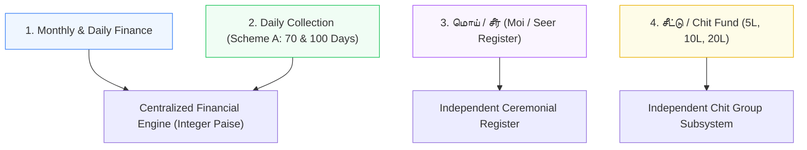

# CPN RAJA – FINANCE MANAGEMENT SYSTEM
### Enterprise Financial Management & Operations Platform

[](#7-automated-test-suite)
[](https://nodejs.org)
[](https://react.dev)
[](https://vitejs.dev)
[](https://mongodb.com)

A robust, production-grade financial management platform custom-built for **CPN Raja's Finance Business**. 

This system manages customers, multiple concurrent loan accounts per customer, daily collection tracking with upfront interest deduction, independent ceremonial gift bookkeeping (மொய் / சீர்), multi-lakh chit fund group administration (சீட்டு / Chit Fund), double-entry audit ledgers, automated due notifications in `Asia/Kolkata` timezone, and segregated financial reports.

---

## 1. TECHNOLOGY STACK

- **Frontend:**
  - React.js 19
  - Vite (1.4s production build)
  - Tailwind CSS v4 (Full mobile 320px to desktop 1920px responsive ergonomics)
  - Lucide React Icons
  - Recharts (Interactive financial analytics & trends)
  - Axios (with Bearer JWT interceptors and auto-logout on expiration)
  - Printable Receipt & Statement templates (`@media print` CSS)

- **Backend:**
  - Node.js & Express.js 5.3
  - RESTful APIs with input sanitization and ReDoS protection
  - Centralized financial calculation engine (Integer Paise precision)
  - Luxon (`Asia/Kolkata` calendar and leap year math)
  - Helmet security headers, Gzip compression, and rate limiting

- **Database & Security:**
  - MongoDB & Mongoose with compound indexing for sub-25ms queries
  - Multi-document ACID transactions (with standalone fallback)
  - JWT Authentication & bcrypt password hashing
  - Idempotency key protection for payment collections (double-click prevention)
  - Immutable audit trail (`AuditLog` and `ChitAuditLog`)
  - Audited financial reversals (zero hard deletions of confirmed transactions)

---

## 2. THE FOUR INDEPENDENT BUSINESS MODULES



### Module 1: Monthly & Daily Finance
- **Monthly Finance:** Simple interest calculated strictly on eligible completed calendar months: $\text{Interest} = \frac{\text{Principal} \times \text{Rate} \times \text{Months}}{100}$.
- **Daily Finance:** Daily interest calculated on active calendar days in `Asia/Kolkata` timezone: $\text{Interest} = \frac{\text{Principal} \times \text{Rate} \times \text{Days}}{100}$.
- **Daily Collection Finance:** Fully replaces legacy Meater finance module; comprehensive 70/100-day daily collection with upfront deduction or extended days repayment schemes.

### Module 2: Daily Collection (Scheme A – முன் வட்டி)
- Upfront interest deduction at inception (e.g. ₹10,000 on ₹1,00,000 gross loan).
- Customer receives Net Amount (₹90,000) and repays gross principal in **70 or 100 equal daily instalments**.
- Day 70 or Day 100 absorbs any integer division remainder (odd paise) ensuring zero leakage.
- Upfront interest is never collected twice in daily instalments.
- Interactive day-by-day visual tracker grid with payment status badges (PAID, PARTIAL, MISSED, UPCOMING).

### Module 3: மொய் / சீர் (Moi / Seer Management)
- Independent ceremonial record-keeping for cash and material gifts.
- Supports Money (in ₹) and Material (item name, quantity, description e.g. "2 Silver Plates").
- Person directory tracking recurring contributors across villages and districts.
- Completely isolated from finance loan balances, ledgers, and collection summaries.

### Module 4: சீட்டு / Chit Fund Management
- Independent chit group subsystem supporting three standard tiers:
  - **₹5,00,000** (5 Lakh Chit)
  - **₹10,00,000** (10 Lakh Chit)
  - **₹20,00,000** (20 Lakh Chit)
- Structure: Exactly 20 members, 20 monthly instalments, 20-month duration.
- Approved monthly schedules with dividend (கசர்) and net payable calculations.
- Monthly collection sheets, payout tracking (பட்டுவாடா), and 6 dedicated chit financial reports.

---

## 3. FINANCIAL PRECISION ENGINE (INTEGER PAISE)

All monetary values across backend models and calculations are stored in **integer paise** ($1\text{ INR} = 100\text{ paise}$):
- Prevents IEEE 754 floating-point rounding errors (e.g. `19.99 * 100 = 1998.9999999999998`).
- Strict integer mathematics for debits, credits, and running balances.
- Clear separation between accrued interest and collected interest.
- Never conflates principal capital with business income.

---

## 4. PROJECT STRUCTURE

```
CPN-Finance-Management/
├── backend/
│   ├── src/
│   │   ├── config/             # Database connection & constants
│   │   ├── controllers/        # Express route controllers (lean queries)
│   │   ├── middleware/         # Auth, error handling, rate limiting
│   │   ├── models/             # Mongoose schemas with compound indexes
│   │   ├── routes/             # RESTful API route definitions
│   │   ├── scripts/            # Backup, restore, provision-admin, clear-demo
│   │   ├── services/           # Financial calculation engine & audit service
│   │   ├── utils/              # Input sanitization & ReDoS escape helpers
│   │   ├── app.js              # Express app definition & security headers
│   │   └── server.js           # Production server & environment validation
│   ├── tests/                  # 121 automated test suites
│   ├── backups/                # Local database JSON snapshots (git-ignored)
│   ├── .env.example            # Backend environment template
│   └── package.json
├── frontend/
│   ├── src/
│   │   ├── components/         # Reusable modals, navbars, sidebars
│   │   ├── context/            # AuthContext & session management
│   │   ├── pages/              # Responsive dashboard, loans, DC, Chit, Moi/Seer
│   │   ├── utils/              # INR formatters & badge helpers
│   │   ├── api.js              # Axios client with VITE_API_URL support
│   │   └── App.jsx
│   ├── .env.example            # Frontend environment template
│   ├── vercel.json             # Vercel SPA rewrite configuration
│   └── package.json
├── DEPLOYMENT.md               # Complete production operations manual
└── package.json
```

---

## 5. QUICK START & LOCAL DEVELOPMENT

### Prerequisites
- Node.js v18 or higher (tested on Node v26)
- MongoDB instance (Local MongoDB or MongoDB Atlas)

### Setup Instructions
1. Install dependencies:
   ```bash
   npm run install:all
   ```

2. Configure backend environment:
   ```bash
   cp backend/.env.example backend/.env
   # Edit backend/.env with your MongoDB URI and JWT_SECRET
   ```

3. Provision initial administrator:
   ```bash
   npm run provision-admin
   ```

4. Run development servers:
   ```bash
   # Terminal 1: Backend API (port 5000)
   npm run start:backend

   # Terminal 2: Frontend Vite (port 5173)
   cd frontend && npm run dev
   ```

---

## 6. PRODUCTION DEPLOYMENT COMMANDS

| Task | Command | Description |
| :--- | :--- | :--- |
| **Production Build** | `npm run build:frontend` | Compiles and minifies React 19 frontend into `frontend/dist` in ~1.4s |
| **Start Backend** | `npm start` | Validates environment variables and starts Express API on port 5000 |
| **Database Backup** | `npm run backup` | Creates a full timestamped JSON snapshot of all MongoDB collections |
| **Database Restore** | `npm run restore` | Restores database from latest (or specified) JSON backup |
| **Demo Data Cleanup**| `npm run clear-demo` | Safely clears demo/test records with automated pre-cleanup backup |
| **Admin Provisioning**| `npm run provision-admin`| Provisions or updates the administrator account securely |
| **Run Test Suite** | `npm test` | Runs all 121 automated unit, API, and audit tests |

---

## 7. AUTOMATED TEST SUITE

The application is backed by an automated test suite verifying all calculation logic, cross-module isolation, idempotency, and security:

```bash
npm test
```

### Test Coverage Breakdown:
- **Calculation Engine (Jest):** 21 / 21 Tests (100%)
- **Financial Core API Suite:** 10 / 10 Tests (100%)
- **மொய் / சீர் (Moi / Seer) API Suite:** 47 / 47 Tests (100%)
- **Daily Collection API Suite:** 15 / 15 Tests (100%)
- **சீட்டு / Chit Fund API Suite:** 20 / 20 Tests (100%)
- **System Audit & Isolation Suite:** 8 / 8 Tests (100%)
- **TOTAL:** **121 / 121 PASSED WITH ZERO FAILURES**

---

## 8. SECURITY & PRODUCTION INTEGRITY

1. **No Hardcoded Credentials:** Login form requires authentic credentials; demo accounts and default passwords are not exposed in client code.
2. **ReDoS & Injection Protection:** User search inputs are sanitized with `escapeRegex()` before querying MongoDB.
3. **Double-Click Idempotency:** Duplicate payment submissions are intercepted via idempotency tokens.
4. **Environment Verification:** Server validates mandatory configuration (`MONGODB_URI`, `JWT_SECRET`) on startup and fails safely if missing.
5. **Audited Reversals:** Transactions are never hard-deleted; reversals maintain a complete audit trail with user, timestamp, and business reason.

For step-by-step deployment to **Vercel** and **MongoDB Atlas**, see the [DEPLOYMENT.md](DEPLOYMENT.md) manual.
